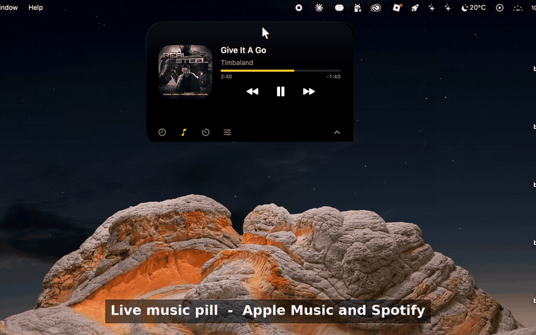
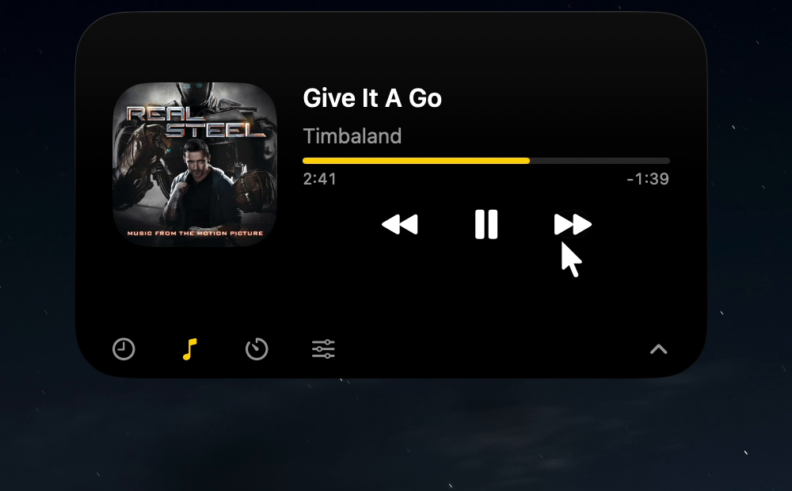
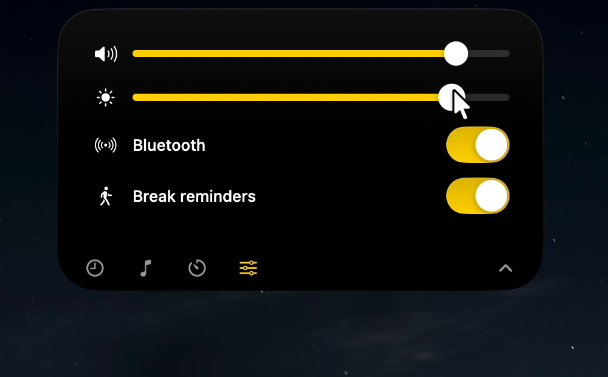
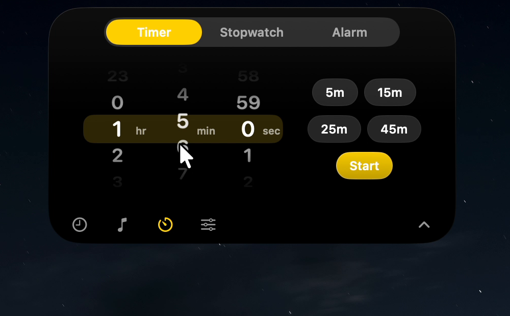
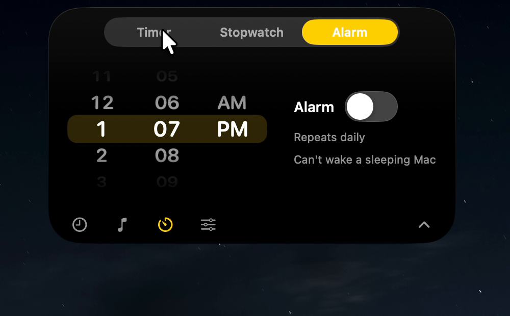

# Dynamic Island for macOS

A native, lightweight "Dynamic Island" for Macs without a notch. Built in **Swift, SwiftUI and AppKit** with no third-party dependencies and no Electron. Developed and tested on an Intel MacBook Pro (macOS Tahoe).



## Features

| | |
|---|---|
| **Live music pill** | Shows album art and a moving equalizer for Apple Music and Spotify. Open it for title, artist, progress and previous / play-pause / next. Spotify ad detection is experimental. |
| **Timer, stopwatch, alarm** | iOS-style free-scrolling wheels with momentum, rolling digits, a daily alarm with snooze. Running timers are tracked live in the pill. |
| **Controls** | Volume, display brightness and Bluetooth, plus a break-reminder switch. |
| **Power** | Charging pop-up with macOS's own time-to-full estimate, an unplug animation, low-battery alerts. |
| **Break reminders** | Gentle nudge after continuous use (default 60 min). Configurable and easy to turn off. |
| **Weather** | Current temperature beside the date (Open-Meteo, no account needed). |
| **Wake greeting** | Good morning / afternoon / evening / night when your Mac wakes. |
| **Appearance** | Auto / dark / light, solid / tinted / glass styles, 8 accent colours. |
| **Position** | Drag anywhere, lock it, reset it. Remembered per display. |

<p>
  
  
  
  
</p>

## Install

Requires macOS 13 or later and Apple's Command Line Tools.

```bash
xcode-select --install        # once; "already installed" is fine
git clone https://github.com/sainishrajput-Apk/dynamic-island-macos.git
cd dynamic-island-macos
chmod +x build.sh make_dmg.sh
./build.sh                    # builds "build/Dynamic Island.app"
open "build/Dynamic Island.app"
```

The app is ad-hoc signed, not notarized. If macOS blocks it, right-click the app and choose **Open**. Drag it into `/Applications` and turn on **Launch at login** in Settings if you like. `./make_dmg.sh` creates an installer.

## Permissions

- **Automation (Music, Spotify):** asked the first time you use music controls or artwork.
- **Bluetooth:** may be requested when you use the Bluetooth switch.
- Nothing else. No Accessibility, no Screen Recording, no Full Disk Access.

## How it works

- A borderless, non-activating `NSPanel` hosts a SwiftUI view, so it never steals focus.
- **Event-driven:** battery (IOKit power-source notifications), volume (CoreAudio listeners), music (distributed notifications), wake / unlock (NSWorkspace). The only recurring timer fires once a minute, on the minute, for the clock and break check.
- Timers and alarms use absolute dates with one-shot timers and are re-checked after sleep.
- Window drag, lock and per-display position are handled in a custom `NSPanel.sendEvent` so clicks and drags inside the panel (sliders, wheels) keep working.
- Source lives in `Sources/DynamicIsland/` (one file per concern: `MusicManager`, `BatteryManager`, `VolumeManager`, `TimerManager`, `WeatherManager`, `BreakMonitor`, `IslandController`, and the SwiftUI views).

## Honest limitations

- The equalizer bars are decorative. They are not driven by the audio (macOS provides no spectrum data without screen-recording permission).
- Brightness and Bluetooth use **private Apple functions** loaded at runtime. A macOS update could break them; the control hides itself if the function is missing.
- macOS has no public API to read other apps' notifications, so notifications are not included.
- Music supports Apple Music and Spotify only. YouTube support would need a browser extension.
- Album art can fail to load for some tracks.
- An alarm cannot wake a sleeping Mac.
- Charging time is macOS's own estimate; it may say "Calculating" for the first minute.
- Not notarized. Tested on one Intel MacBook Pro; other Macs are untested.

## Roadmap

Calendar, system monitor (CPU, memory, network), QR code from clipboard, Mail alerts, download and screenshot progress, translator, notes.

## About this project

I built this to learn native macOS development, working with **AI assistance (Claude)** for much of the implementation, and testing and iterating on my own Mac. Contributions and issues are welcome.

## License

MIT. See [LICENSE](LICENSE).
